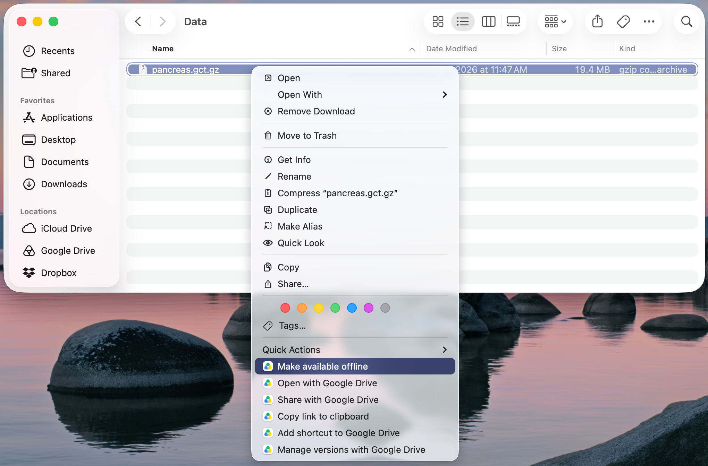
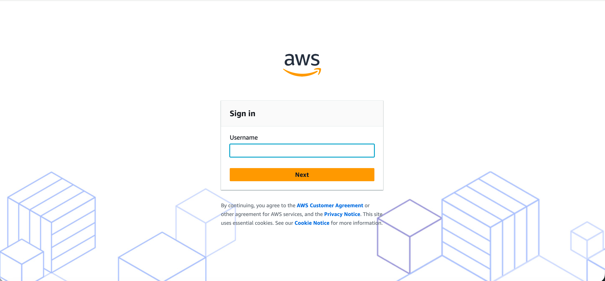
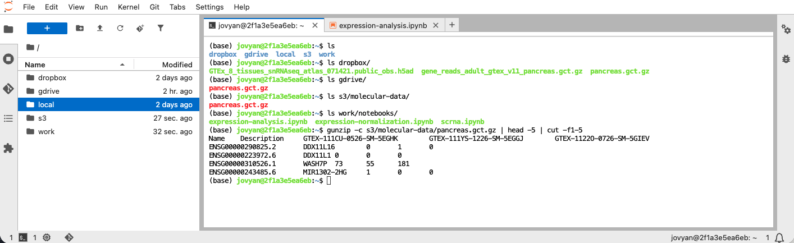

_The [scientific method](https://en.wikipedia.org/wiki/Scientific_method) is an iterative loop: observation leads to questioning, questioning to hypothesizing, hypothesizing to experimentation, and experimentation to results, which in turn prompt new observations, and so on. Although the overall cycle is deterministic in structure, it is not fatalistic in outcome. A testable hypothesis yields an answer with only some degree of probability, and the complexity of the search space within each loop shapes the choices made and, therefore, the results achieved. For these reasons, the outcomes of research and development are difficult to predict, and the work may often be costly. Recouping those costs through intellectual property (IP), applied insight, or products is not guaranteed; it is a bet placed by innovators. Accordingly, any reduction in the time or cost of a cycle improves the odds that the bet pays off._

**For individuals with agents, or small teams working with data, I present a practical framework for bootstrapping a research playground and loop. The framework enables fast, standardized, exploratory iteration with a shareable record of input and output at a low, to no cost.** By the end, you’ll have a one-command JupyterLab environment built from a Git repo, read-only access to data in Dropbox, Google Drive, and Amazon S3, a lightweight record of which code and data produced each result, and a way for agents to rerun your notebooks in the same environment you use.

---

## Overview of Tooling Scaffold and Framework

Whether working alone, with an agent, or with a team, research is made up of iterative cycles of trial and error. Not all research requires heavy compute, and much of the exploratory work may be separated out and performed in a low cost environment. Here is a framework for a low cost, shareable, and standardized data playground to decrease the cost and time of research cycles:

1. **A code repository to store, maintain, share, and track the build of a standardized container ($0/month).** I’m using [GitHub Free for personal accounts](https://docs.github.com/en/get-started/learning-about-github/githubs-plans#github-free-for-personal-accounts), which allows unlimited private repositories (with some feature limitations) and unlimited collaborators. The repository contains instructions for building and running a container with [Docker](https://www.docker.com/), which is also free for small businesses. _A standard environment for code execution reduces startup time to a single build description, and reduces each team member’s overhead._
2. **A code repository to store, maintain, share, and track new and exploratory research ($0/month).** I use the same free private repository to store notebooks and scripts, which I run and update inside the standardized container on my MacBook Neo. Any changes to shared notebooks are committed to the shared repository and tracked with `git`. _Agents and humans, alike, may access and collaborate on exploratory code together, reducing time to hardening._
3. **Shared storage for input data ($0/month and up).** There are many options on the market. [Google Drive](https://workspace.google.com/products/drive/) has a free, shareable option. I use a combination of [Dropbox](https://www.dropbox.com/) (annual subscription) and [Amazon S3](https://aws.amazon.com/s3/) (Amazon Simple Storage Service, which charges for storage and data egress, the transfer of data out of the cloud), and [iCloud](https://www.icloud.com/). [Azure Blob Storage](https://azure.microsoft.com/en-us/products/storage/blobs) and [Google Cloud Storage](https://cloud.google.com/storage) are also options, with costs similar to Amazon S3. If needed, setting up a small server with private network access is possible, too. _For exploratory iterations, file size is typically small and free shared storage is more and more abundant._
4. **Shared storage for output artifacts ($0/month and up).** The options are the same as for input data: a mix of free, fixed-price, and pay-as-you-go services. _For artifacts, I write results back to local storage and then decide whether to write back to shared storage._
5. **A compute source to build and run the container (~$200 and up, one-time).** Any work with data requires a compute source, and there are plenty of options when buying new. Exploratory and investigative work doesn’t require heavy compute: 8 GB of RAM (random access memory) is more than enough to sketch out and test different algorithms. I’m a big fan of the [MacBook Neo](https://www.apple.com/macbook-neo/) and also have a [Mac mini](https://www.apple.com/mac-mini/). [Chromebooks](https://www.google.com/intl/en_us/chromebook/) are great, inexpensive options too, however 4 GB of RAM may run into performance issues more frequently. For the minority of cases that need heavy compute, such as large-scale processing or production-grade implementations, you may need to run the workflow on a cloud provider with pay-as-you-go pricing. _Every employee or contractor needs a computer anyway, so this cost will likely already be covered through a separate budget, making the compute cost effectively $0 for our purposes._

 _Standardized and sharable data playgrounds reduce friction within and between iterative research loops, decreasing research cycle time. Here, authorized humans and agents have separate access to each of code (GitHub), storage (Google Drive, Dropbox, Amazon S3), and compute (MacBook Neo + Docker). The result is a low friction communication loop which enables a human to explore in a standardized environment, send artifacts to either human or agent, and then repeat the cycle._

## Setup

### Initiate Accounts

Depending on which component is used, shared users may or may not need to set up accounts with each solution providers. At a minimum, the research lead should do the following:

1. Install Docker Desktop via [Docker](https://www.docker.com/), or use a popular alternative such as [Podman](https://podman-desktop.io/), [Rancher](https://rancherdesktop.io/), or [Colima](https://github.com/abiosoft/colima).
2. Set up shared storage. Google Drive, Dropbox, iCloud, AWS, Azure, Google Cloud all require an account to administer shared storage. [Google Drive](https://workspace.google.com/products/drive/), [Dropbox](https://www.dropbox.com/), and [iCloud](https://www.icloud.com/) may require downloading a supporting package to the local environment for data access. [Amazon S3](https://aws.amazon.com/s3/) and other cloud providers require configuration before local access is gained.
3. Set up a shared repo via [GitHub](https://github.com/), or an alternative code repo.

### Connect to Storage

To mount drives to your local environment (e.g. Google Drive, Dropbox), make sure to install the provider’s desktop app. As a default, files may not exist on your hard drive right away, and it may be necessary to toggle settings for either the whole drive, a directory, or a single file. For Google Drive, this means selecting a folder and marking it as `available offline`.



For buckets within cloud accounts, it may be necessary to establish a configuration within the account, before achieving access to the bucket via CLI. For Amazon S3, that involves setting up a user in the **IAM Identity Center** and adding a permission set:

```
{
  "Version": "2012-10-17",
  "Statement": [
    { "Effect": "Allow", "Action": "s3:ListBucket", "Resource": "arn:aws:s3:::my-bucket" },
    { "Effect": "Allow", "Action": "s3:GetObject",  "Resource": "arn:aws:s3:::my-bucket/*" }
  ]
}
```

Create or reuse an existing bucket and assign a bucket policy:

```
{
  "Version": "2012-10-17",
  "Statement": [{
    "Sid": "DenyInsecureTransport",
    "Effect": "Deny",
    "Principal": "*",
    "Action": "s3:*",
    "Resource": ["arn:aws:s3:::my-bucket", "arn:aws:s3:::my-bucket/*"],
    "Condition": { "Bool": { "aws:SecureTransport": "false" } }
  }]
}
```

Install `awscli` (if needed) and set up the connection config

```bash
brew install awscli

aws configure sso
```

During configuration, you’ll be prompted to answer a few questions. For example, you’ll need to specify the profile name, e.g. `s3-ro` which will be used whenever you sign in to Amazon s3 when you launch, `aws sso login --profile s3-ro`. When you launch the research environment (below), you’ll be prompted to securely login for bucket access given your settings:



### Author the Dockerfile and Design the Build

For a shared research environment, I have [JupyterLab](https://jupyter.org/) installed for interactive code development with shared data.

The GitHub repo, `research-and-development-tooling`, looks like this:

```
research-and-development-tooling/
├── jupyter-research-playground/
    ├── compose.yaml       # a blueprint to define, run, and manage multi-container application
    ├── .env.example       # template for your personal paths; copy to .env (ignored by git)
    ├── Dockerfile         # pinned scipy-notebook + Mountpoint
    ├── requirements.txt   # extra Python packages, pinned
    ├── mount-s3.sh        # mounts the bucket at startup, then removes the credentials
    ├── launch.sh          # signs you in and starts everything
    └── run-notebook.sh    # runs a notebook headlessly in the container (for agents and humans)
├── notebooks/
    ├── my-notebook.ipynb
    └── run_record.py      # writes a manifest of code version + input hashes per run
├── session-artifacts/     # local outputs, ignored by git
├── .gitattributes         # nbstripout filter for clean notebook diffs
├── .gitignore
└── README.md
```

`compose.yaml`:

```yaml
name: jupyter-research-playground

services:
  jupyter:
    build: .
    image: jupyter-research-playground
    user: root
    devices:
      - /dev/fuse
    cap_add:
      - SYS_ADMIN
    ports:
      - "127.0.0.1:8888:8888"
    volumes:
      # 1. GitHub repo for notebooks, read-write (relative to this file, so it works in any clone)
      - "../notebooks:/home/jovyan/work/notebooks/"
      # 2. Local folder for ad hoc items ignored by GitHub, read-write
      - "../session-artifacts/:/home/jovyan/local"
      # 3. Shared Dropbox folder, read-only (:ro); path comes from your .env
      - "${DROPBOX_DATA_DIR}:/home/jovyan/dropbox:ro"
      # 4. Shared Google Drive, read-only (:ro); path comes from your .env
      - "${GDRIVE_DATA_DIR}:/home/jovyan/gdrive:ro"
      # 5. S3 local cache, kept across restarts
      - s3cache:/cache
    environment:
      S3_BUCKET: ${S3_BUCKET}
      AWS_REGION: ${AWS_REGION:-us-east-1}
      # Set by launch.sh so each run can record which commit produced it
      GIT_SHA:
      # No values here, so Compose copies it from your shell at launch time. Nothing secret is written in this file.
      AWS_ACCESS_KEY_ID:
      AWS_SECRET_ACCESS_KEY:
      AWS_SESSION_TOKEN:

volumes:
  s3cache:
```

Each collaborator’s Dropbox and Google Drive paths differ, so personal paths live in a `.env` file next to `compose.yaml`, which Compose reads automatically and git ignores. Commit a template, `.env.example`, and have each person copy it to `.env`:

```bash
# Copy to .env (ignored by git) and fill in your own paths
DROPBOX_DATA_DIR="/Users/you/Library/CloudStorage/Dropbox/Data/examples"
GDRIVE_DATA_DIR="/Users/you/Library/CloudStorage/GoogleDrive-you@gmail.com/My Drive/data"
S3_BUCKET="yourbucket-123456789-us-east-1-an"
AWS_REGION="us-east-1"
```

**A note on** `user: root`**,** `/dev/fuse`**, and** `SYS_ADMIN`**:** Mountpoint uses FUSE (Filesystem in Userspace), and a container needs these to mount a filesystem. The container starts as root only long enough to mount the bucket. The Jupyter image’s startup script then switches to the unprivileged `jovyan` user before JupyterLab runs. Because the container holds an elevated capability, keep the port bound to `127.0.0.1`, as above, so the server is never exposed to your network. On Linux hosts with AppArmor, you may also need `security_opt: ["apparmor:unconfined"]`.

`Dockerfile`:

```
# Pin the base image so everyone who builds gets the same environment. Avoid :latest.
# For stricter pinning, use a dated tag or an @sha256 digest from quay.io/jupyter/scipy-notebook.
FROM quay.io/jupyter/scipy-notebook:python-3.12
USER root
# For strict reproducibility, swap "latest" for a specific Mountpoint release
RUN apt-get update && apt-get install -y --no-install-recommends wget \
 && ARCH=$(dpkg --print-architecture | sed 's/amd64/x86_64/') \
 && wget -q https://s3.amazonaws.com/mountpoint-s3-release/latest/${ARCH}/mount-s3.deb \
 && apt-get install -y ./mount-s3.deb \
 && rm mount-s3.deb && rm -rf /var/lib/apt/lists/*
COPY mount-s3.sh /usr/local/bin/before-notebook.d/10-mount-s3.sh
USER ${NB_UID}
COPY requirements.txt /tmp/requirements.txt
RUN pip install --no-cache-dir -r /tmp/requirements.txt
```

`requirements.txt` (anything you add beyond what `scipy-notebook` ships, pinned to exact versions):

```
papermill==2.6.0
```

`mount-s3.sh`:

```bash
# The image's startup script sources (rather than executes) .sh files in before-notebook.d,
# so the unset at the bottom also removes the credentials from JupyterLab's environment.
# Keep the .sh extension if you rename this file.
S3_MOUNT=/home/jovyan/s3   # inside the home folder, so it shows in JupyterLab's file browser

if [ -n "${AWS_ACCESS_KEY_ID:-}" ]; then
  mkdir -p "$S3_MOUNT" /cache/s3
  mount-s3 "$S3_BUCKET" "$S3_MOUNT" \
    --read-only \
    --region "$AWS_REGION" \
    --cache /cache/s3 --metadata-ttl 300 \
    --allow-other --uid "${NB_UID:-1000}" --gid "${NB_GID:-100}" \
    || echo "WARNING: S3 mount failed"
else
  echo "No AWS credentials passed in; skipping S3 mount (run ./launch.sh)"
fi

# Mountpoint keeps the credentials in its own memory; remove them before notebooks start
unset AWS_ACCESS_KEY_ID AWS_SECRET_ACCESS_KEY AWS_SESSION_TOKEN
```

`launch.sh`:

```
#!/usr/bin/env bash
set -euo pipefail
PROFILE=s3-ro

# Browser sign-in. Returns quickly if your session is still valid.
aws sso login --profile "$PROFILE"

# Temporary credentials, held only in this script's memory
eval "$(aws configure export-credentials --profile "$PROFILE" --format env)"

# Record which commit (and whether there were uncommitted edits) this session runs
export GIT_SHA="$(git rev-parse --short HEAD)$(git diff --quiet || echo -dirty)"

docker compose up --build
```

`.gitignore` :

```
notebooks/.ipynb_checkpoints/
session-artifacts/
.env
```

## Launching the Research Workflow

Once the repo is cloned locally, copy `.env.example` to `.env`, fill in your paths, and run `launch.sh` from the `jupyter-research-playground` directory:

```bash
user@MacBook-Neo jupyter-research-playground % ./launch.sh
```

If your AWS session has timed out, you will be prompted to login via your browser. In the log output from docker, you’ll receive the URL to access your storage connected JupyterLab instance. Open that URL in your browser to access your shared data:



Shared storage appears in the directory on the left. Notebooks which you create and/or edit may be saved back to your local repo clone (in the above JupyterLab instance, the directory for notebooks is `work/notebooks`), and committed back to the remote repo in GitHub for review.

Two behaviors of the S3 mount are worth knowing before a long session:

- **Credentials expire.** Mountpoint receives temporary credentials at launch. IAM Identity Center permission sets default to a one-hour session, and after that, any S3 file not already in the local cache will fail to read, even though JupyterLab looks healthy. Relaunch with `./launch.sh`, or raise the permission set’s session duration (up to 12 hours) in IAM Identity Center.
- **New files appear after a short delay.** The mount caches the bucket’s file listing for five minutes (`--metadata-ttl 300`). If your input data never changes, `--metadata-ttl indefinite` is faster; if collaborators add files often, lower it.

---

## Keeping a Record of Inputs and Outputs

A playground becomes a research loop when you can answer, weeks later, “which code and which data produced this result?” Three small conventions get you most of the way there.

**1\. Clean notebook diffs.** Notebooks store outputs and execution counts in the file itself, which makes `git` diffs noisy and reviews painful. [nbstripout](https://github.com/kynan/nbstripout) strips them on commit. Each collaborator runs this once on their own machine (not in the container):

```bash
pipx install nbstripout
nbstripout --install --attributes .gitattributes
```

Commit the resulting `.gitattributes` so the filter applies to everyone who installs it.

**2\. A manifest for every run.** Inputs in Dropbox, Google Drive, or S3 can change underneath you. A small helper in `notebooks/run_record.py` creates a folder per run and records the commit and a fingerprint (SHA-256 hash) of every input file:

```python
import datetime, hashlib, json, os, pathlib

def start_run(name, inputs, root="/home/jovyan/local/runs"):
    """Create a run folder and record which code version and input files it used."""
    git_sha = os.environ.get("GIT_SHA", "unknown")
    stamp = datetime.datetime.now().strftime("%Y%m%d-%H%M%S")
    run_dir = pathlib.Path(root) / f"{stamp}-{name}-{git_sha}"
    run_dir.mkdir(parents=True)
    manifest = {
        "git_sha": git_sha,
        "inputs": {
            str(p): hashlib.sha256(pathlib.Path(p).read_bytes()).hexdigest()
            for p in inputs
        },
    }
    (run_dir / "manifest.json").write_text(json.dumps(manifest, indent=2))
    return run_dir
```

At the top of a notebook:

```python
from run_record import start_run

run_dir = start_run("churn-baseline", ["/home/jovyan/dropbox/customers.csv"])
# ... analysis ...
results.to_csv(run_dir / "results.csv")
```

If two runs disagree, compare their manifests: either the code changed (`git_sha`) or the data did (the hashes). For large files, hashing reads the whole file, so for those you may prefer to record size and modified time, or turn on [S3 Versioning](https://docs.aws.amazon.com/AmazonS3/latest/userguide/Versioning.html) and record version IDs.

**3\. Promote outputs deliberately.** Runs land in `session-artifacts/runs/` on your machine. When a result is worth sharing, copy its whole run folder, manifest included, to shared storage. _The record travels with the result, so anyone who opens it knows exactly how it was made._

## Working with Agents

Agents such as [Claude Code](https://www.anthropic.com/claude-code) work best when they can run the same code in the same environment you do, without access to anything they don’t need. This setup already does most of the work: inputs are read-only, credentials never reach the notebook environment, and every change to a notebook is a `git` diff a human can review.

The missing piece is a way to _execute_ notebooks without a browser. `run-notebook.sh` runs a notebook headlessly with [papermill](https://papermill.readthedocs.io/) inside the running container, as the unprivileged user, with the AWS credentials blanked out:

```bash
#!/usr/bin/env bash
# Usage: ./run-notebook.sh my-notebook.ipynb [-p param value ...]
set -euo pipefail
cd "$(dirname "$0")"
NB="$1"; shift
OUT="/home/jovyan/local/$(date +%Y%m%d-%H%M%S)-${NB%.ipynb}.ipynb"

docker compose exec --user jovyan \
  -e AWS_ACCESS_KEY_ID= -e AWS_SECRET_ACCESS_KEY= -e AWS_SESSION_TOKEN= \
  jupyter papermill "work/notebooks/$NB" "$OUT" --cwd work/notebooks "$@"
```

The credential overrides matter: a process started with `docker compose exec` inherits the container’s original environment, which still contains the AWS keys passed in at launch. Blanking them keeps agent-run code on the same footing as your notebooks.

An agent working in the repo clone can now edit a notebook, run it with new parameters, read the executed copy and manifest in `session-artifacts/`, and propose a commit. Give it the ground rules in the repo, for example in a `CLAUDE.md` file:

```markdown
- Notebooks live in notebooks/. Edit them on the host; never edit files under session-artifacts/ by hand.
- Run notebooks only with ./jupyter-research-playground/run-notebook.sh <name>.ipynb [-p key value].
- Input data is read-only under /home/jovyan/{dropbox,gdrive,s3}. Never copy it into the repo.
- Before reporting a result, read the run's manifest.json and cite its git_sha.
```

_The agent and the human share one environment, one dataset, and one record, which is what keeps their work comparable._

## Why Not Codespaces, Colab, or Binder?

Hosted notebook services solve part of this problem, and for some teams they are the better choice. Here is how they compare:

| Option | Where it shines | Where this setup differs |
| --- | --- | --- |
| [GitHub Codespaces](https://github.com/features/codespaces) | A standardized container from a repo with nothing installed locally; a monthly free allowance | Data stays on your machine and in your own accounts; Dropbox and Google Drive folders mount directly; no compute-hour limits; works offline |
| [Google Colab](https://colab.research.google.com/) | Zero setup; free GPUs for short sessions | The environment is defined in your repo rather than reinstalled each session; notebooks are versioned with git; sessions don’t time out |
| [Binder](https://mybinder.org/) | Shareable, reproducible public notebooks | Works with private data and private repositories |

They aren’t mutually exclusive. The same Dockerfile can back a [dev container](https://containers.dev/) definition, so a collaborator without Docker can open the repo in Codespaces and still get the same environment.

## Tradeoffs

No setup is free of costs, and this one has a few:

- **Setup time is the real cost.** GitHub, Docker, and a shared Drive folder take minutes. Adding S3 with IAM Identity Center, SSO, and FUSE can take an afternoon the first time. If you’re working alone with small files, skip S3 entirely.
- **It assumes macOS.** The cloud-storage paths above are macOS-specific. Linux and Windows work, but the paths differ, and Chromebooks generally can’t run the desktop sync apps.
- **The S3 mount needs elevated privileges.** `SYS_ADMIN` is a real capability. It’s reasonable on your own machine and a reason not to run this setup on shared infrastructure.
- **The record is lightweight, not airtight.** Manifests tell you when data changed, but not what it was before. For that, you need versioned storage or a data-versioning tool such as [DVC](https://dvc.org/).
- **8 GB of RAM is workable, not roomy.** Docker’s virtual machine, JupyterLab, and a dataframe all share it.

## Where This Goes Next

Exploration is only a portion of the loop. When a notebook settles into something worth keeping, move its functions into a small package in the same repo, add tests, and run them in the same container. Because the environment is already pinned and defined in code, the path from playground to pipeline is a change in where the container runs, whether a CI job or a pay-as-you-go cloud instance, not a rebuild from scratch.

_Every cycle that is cheaper, faster, and better recorded improves the odds that the bet pays off._
